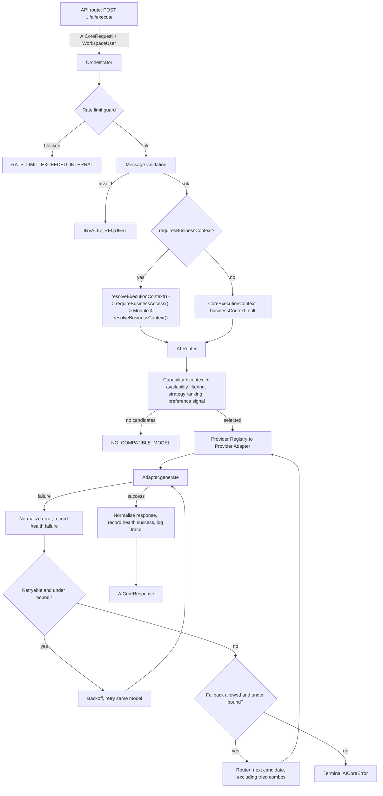

# AI Core (Module 5A) — Foundation, Provider Abstraction, Routing & Orchestration

This document covers `src/modules/ai/core/` — the provider-independent AI
execution foundation every future MarketMitra AI feature is built on.

**The one rule everything here enforces:** no future feature calls a
provider SDK directly. Everything goes through
`executeAICoreRequest()` in `orchestrator.ts`.

---

## 1. Architecture overview

## 2. Module boundaries

**Owns:** provider abstraction/adapters, capability system, Model
Registry, task requirements contract, routing policy, provider health,
retry/fallback policy, error normalization, core request/response
contracts, the Orchestrator, the Module 4 integration boundary, the
streaming contract, the execution trace contract.

**Does not own:** long-term AI memory, memory extraction/retrieval (5B);
Knowledge Base, document ingestion, embeddings, vector DB, RAG (5C);
prompt management/versioning, AI Tool Registry, autonomous agents (5D);
full usage/cost accounting (5E); marketing workflows, Chat UI (Module 6).

## 3. Repository audit findings

`docs/ARCHITECTURE.md` §5 already *described* this architecture
(`provider.interface.ts`, `provider.factory.ts`, `generation.service.ts`)
as if built — none of it existed; only `src/modules/ai/demo-contract.ts`
(the marketing demo, untouched) did. What genuinely pre-existed and is
reused as-is: `env.ts`'s `AI_PROVIDER` enum + per-provider keys +
`isDefaultAIProviderConfigured`; `Workspace.preferredAIProvider` and the
`AIProviderName` Prisma enum; all three target SDKs already installed
(`openai@4.78.1`, `@anthropic-ai/sdk@0.32.1`, `@google/generative-ai@0.21.0`);
`ioredis`, `@upstash/ratelimit`, `REDIS_URL` (see §27's mismatch note);
`src/lib/logger.ts`, `src/lib/api-response.ts` (extended), Module 3 RBAC,
Module 4's `resolveBusinessContext`.

## 4. Provider contract

`types/provider.ts` — `AIProvider` interface,
`ProviderGenerationRequest`/`ProviderGenerationResponse` (non-streaming),
`ProviderStreamRequest` (streaming). Provider-native SDK types never
cross this boundary.

## 5. Normalized message contract

`types/message.ts` — `NormalizedMessage` with `SYSTEM|USER|ASSISTANT|TOOL`
roles and typed `content: MessagePart[]` (text now; `image` part reserved
for future VISION). `validateMessages()` enforces ordering. Each
adapter's `to*Messages()` helper translates to that provider's native
shape — provider message objects never escape the adapter.

## 6. Capability system

`types/capability.ts` — `TEXT_GENERATION | STREAMING | STRUCTURED_OUTPUT |
TOOL_CALLING | VISION | EMBEDDINGS | LONG_CONTEXT`. `hasAllCapabilities`/
`missingCapabilities` are what the router uses to hard-filter candidates.

## 7. Provider Registry

`providers/provider.registry.ts` — the only place a concrete adapter is
resolved. Duplicate provider IDs throw at module-load time.

## 8. Model Registry

`models/model.registry.ts` — every model ID hardcoded exactly once.
**Maintenance:** edit `MODEL_DEFINITIONS`; never claim a capability a
model doesn't truly support; retire via `lifecycle: "DEPRECATED"`, don't
delete rows. Cost/speed tiers are qualitative — real pricing is 5E's job.

## 9. Providers operational vs. architecture-only

| Provider | Status | Notes |
|---|---|---|
| OpenAI | **Operational** | Real SDK, error normalization, streaming |
| Anthropic | **Operational** | Real SDK, error normalization, streaming |
| Google Gemini | **Operational** | Real SDK, error normalization, streaming |
| xAI Grok | Architecture-only | Not registered — see registry's extension-point docstring |
| DeepSeek | Architecture-only | Same |

"Operational" = real SDK integration + real translation + real
normalization. It does **not** mean "configured in this environment."

## 10. Model availability states

`REGISTERED -> CONFIGURED -> AVAILABLE`, or `UNAVAILABLE`/`DEPRECATED`. A
key being set does not prove reachability — only `isConfigured()` +
passive health together produce `AVAILABLE`.

## 11. Task requirements contract

`types/routing.ts`'s `AITaskRequirements` — hard constraints
(`requiredCapabilities`, `minContextTokens`, `*Required` flags) vs. soft
signals (`preferredCapabilities`, `preferredProvider`, `preferredModelId`).
Low-level primitive, not Module 5D's higher-level task registry.

## 12. Routing strategies & decision pipeline

`routing/strategies.ts`: `QUALITY` (capability breadth, then context
window), `FAST` (speed tier), `COST_EFFICIENT` (cost tier), `BALANCED`
(40% speed / 40% cost / 20% capability breadth). All deterministic — model
registry order is the only tiebreaker.

Pipeline (`router.ts::routeRequest`): candidates -> capability filter ->
context-window filter -> availability filter -> strategy ranking ->
preferred-model exact-match short-circuit -> preferred-provider reorder
-> selection. Rejected candidates carry safe internal reason codes,
never shown verbatim to end users.

**Known limitation:** `preferredCapabilities` is accepted/typed but not
used to reorder ranked output yet — see `router.ts`'s inline note on why
a naive implementation risked overriding the chosen strategy.

## 13. Provider/model preferences boundary

A preference can only **select among already-filtered candidates** —
never bypass capability/context/availability filtering. Invalid
preferences are silently ignored. Full persistence is Module 5B.

## 14. Provider health architecture

`policy/health.tracker.ts` — passive, execution-derived only, no active
poller. `UNKNOWN -> HEALTHY` on success; 2-4 consecutive qualifying
failures -> `DEGRADED`; 5+ -> `UNAVAILABLE`; success resets. Only
provider-level codes qualify (RATE_LIMITED, TIMEOUT, PROVIDER_UNAVAILABLE,
NETWORK_ERROR, AUTHENTICATION_ERROR, UNKNOWN_PROVIDER_ERROR) —
request-shaped errors never touch health, preventing one bad request from
marking a provider unhealthy. **Known limitation:** in-memory, per-process,
no cross-instance shared state.

## 15. Error taxonomy

`types/errors.ts` — 11 provider-facing codes + 3 core-level codes
(`NO_COMPATIBLE_MODEL`, `ALL_CANDIDATES_EXHAUSTED`,
`RATE_LIMIT_EXCEEDED_INTERNAL`). Every adapter's `normalize*Error()`
translates real SDK errors into this taxonomy.

## 16. Retry policy

`policy/retry.policy.ts` — bounded (`MAX_RETRIES_PER_MODEL = 2`),
exponential backoff with full jitter, pure functions (no timers).
`CONTEXT_LIMIT_EXCEEDED` is explicitly non-retryable.

## 17. Fallback policy

`policy/fallback.policy.ts` — bounded (`MAX_PROVIDER_ATTEMPTS = 3`),
tracked via a `Set<"provider:modelId">`. Never allowed for
`SAFETY_REFUSAL`/`INVALID_REQUEST`, nor the router's own terminal codes.

## 18. AI Orchestrator

`orchestrator.ts::executeAICoreRequest` — see §1's diagram; extension
hooks documented in the file header and summarized in §29.

## 19. Module 4 Business Context integration

`context/execution-context.service.ts` is the **only** file that imports
from Module 4, using exactly `resolveBusinessContext(workspaceUser,
businessId)` — no direct model queries anywhere in
`src/modules/ai/core/` (verified by grep — see delivery report).
`requireBusinessAccess()` re-checks ownership first. Archived businesses
are rejected by Module 4's existing rule, unchanged. Prompt assembly is
explicitly NOT done here — that's Module 5D, consuming
`CoreExecutionContext` from the pipeline.

## 20. Core request/response contracts

`types/core-request.ts` / `types/core-response.ts`. Requests only ever
contain server-trusted or Zod-validated fields. Responses distinguish
usage kind (`PROVIDER_REPORTED | ESTIMATED | UNAVAILABLE`).

## 21. Finish reason normalization

`types/finish-reason.ts` — `STOP|LENGTH|TOOL_CALL|SAFETY|CONTENT_FILTER|
ERROR|UNKNOWN`. Raw provider strings preserved only as internal metadata.

## 22. Streaming contract

`types/streaming.ts` — `STREAM_STARTED|CONTENT_DELTA|TOOL_CALL_DELTA|
USAGE|STREAM_COMPLETED|STREAM_ERROR`. All three operational adapters
implement real `generateStream()` using each SDK's native streaming API
— no adapter splits a completed response into fake chunks. **The orchestrator
does not use it:** `executeAICoreRequest()` only calls `provider.generate`,
and `streamingRequired` is only a routing filter. There is no orchestrator-level
streaming path and no second entry point; a future one must go through
`resolveExecutionContext()` and `buildProviderSystemInstruction()` (see `docs/AI_MEMORY.md`).
`TOOL_CALL_DELTA` is typed for forward-compat only; not emitted (no tool
calling until 5D). Not unit-tested against live provider streams (needs
live credentials); the finish-reason mapping streaming reuses is tested
directly.

## 23. Execution trace contract

`types/trace.ts` — `AIExecutionTrace` + `logExecutionTrace()`, logging
via the existing pino logger. Never logs secrets; never logs full
message content by default. Typed contract + logger boundary — not 5E's
database-backed observability store.

## 24. Server-only enforcement

Every file touching a provider SDK, Redis, or the logger starts with
`import "server-only"` — no-op on the server, hard build error in a
client bundle. Pure type/logic files deliberately omit this guard.

## 25. API surface

`POST /api/v1/workspaces/{workspaceSlug}/ai/execute` — the only HTTP
entry point in 5A. Fixed to TEXT_GENERATION, non-streaming; client cannot
set capabilities/flags/internal routing policy.

## 26. RBAC

One new permission, `ai:execute`, added to the existing
`WORKSPACE_PERMISSIONS` matrix — same roles as `content:generate`
(ADMIN, TEAM_MEMBER; not CLIENT).

## 27. Rate-limit integration boundary

`rate-limit.ts` — **mismatch found**: `@upstash/ratelimit` peer-depends
on `@upstash/redis` (REST client), but `env.ts` only declares
`REDIS_URL` (pairs with the also-installed `ioredis`). Implementation
uses `ioredis` directly — a real fixed-window counter. Without
`REDIS_URL`, honestly reports `configured: false` and fails open; never
falls back to an in-memory counter. Full plan-aware limiting is 5E/8.

## 28. Idempotency boundary

`AICoreRequest.requestId` is a trusted, server-generated idempotency
reference. Request dedup is architecturally supported but not
implemented (no dedup store yet). AI response caching is Module 5D's
job — conflating the two would be wrong. No cross-tenant dedup.

## 29. Extension points for 5B–5E and Module 6

- **5B:** extend `resolveExecutionContext()`/`CoreExecutionContext` for
  Business AI Preferences + memory retrieval. `Workspace.preferredAIProvider`
  is the natural seed for real preferences persistence.
- **5C:** inject retrieved content into `request.messages` before calling
  `executeAICoreRequest` — RAG retrieval doesn't belong in the orchestrator.
- **5D:** prompt assembly, the AI Task Registry (built on
  `AITaskRequirements`), tool execution (`TOOL_CALL_DELTA`/`TOOL` role
  already exist as forward-compatible surface), AI response caching.
- **5E:** persist `AIExecutionTrace`; real token-based cost accounting;
  plan-aware rate limiting on top of `rate-limit.ts`; shared provider
  health via Redis.
- **Module 6:** consumes `types/streaming.ts` directly — no
  provider-specific code needed. Needs its own purpose-built API route.

---

See `MODULE_5A_DELIVERY_REPORT.md` for validation results, security
review, and test coverage.

## 30. Fix-pass history

**KILLCRITIC fix pass:** removed unimplemented TOOL_CALLING from every model
(deferred to 5D); removed EMBEDDINGS (no embedding model registered);
documented STRUCTURED_OUTPUT as JSON mode only (not schema validation);
implemented real vision translation for OpenAI (`image_url`), Anthropic and
Gemini (base64 via shared `image-resolver.ts`); `preferredCapabilities` now
acts as a secondary tie-break only when strategy scores are exactly equal;
added 13 orchestrator integration scenarios with a deterministic
`FakeProvider`; fixed `generateStream` so an unconfigured provider yields
`STREAM_ERROR` instead of throwing; documented rate limiting as fail-open
and NOT production-grade (Module 5E replaces it).

**Registry + validation pass:** official provider documentation could not be
reached from the build sandbox, so every registry row stays
`metadataVerification: "UNVERIFIED_TRAINING_DATA"`. No model ID was changed,
invented or deprecated. Registry invariant tests were added
(`model-registry.test.ts`). The registry must be verified against current
provider docs by a person with web access before production use.

See `MODULE_5A_DELIVERY_REPORT.md` for validation results.

## 31. Registry safety fix (2026-10-10)

- Production routing requires `metadataVerification: "VERIFIED_AGAINST_DOCS"`.
  `resolveModelAvailability()` checks lifecycle, then verification, then
  provider configuration, so a configured API key cannot make an unverified
  model routable. New typed state: `"UNVERIFIED"` (distinct from
  `"DEPRECATED"`). The router rejects such rows with
  `MODEL_METADATA_UNVERIFIED` before any provider check.
- `listModels()` / `listUnverifiedModels()` remain for registry maintenance;
  `listAvailableModels()` returns only routable models.
- Verified against official docs: `gpt-4o`, `gpt-4o-mini`. Verified retired:
  `claude-3-5-sonnet-20241022` (2025-10-28), `claude-3-5-haiku-20241022`
  (2026-02-19), `gemini-1.5-pro` / `gemini-1.5-flash` (shut down 2025-09-29)
  — marked `DEPRECATED` with sources. Anthropic's documented replacements are
  NOT registered (limits, capabilities and SDK 0.32.1 compatibility unverified).
- Consequence: only OpenAI is routable today; cross-provider fallback has no
  real candidates until verified Anthropic/Gemini models are added.
- Tests use a synthetic fixture catalog (`test/fixtures-model-catalog.ts`,
  installed by `test/setup/model-catalog.ts`); registry tests clear it.

## 32. Business AI Preferences (5B.1)

`CoreExecutionContext` now carries `businessPreferences` (null without business context). See `docs/AI_PREFERENCES.md`.

## 33. Business Memory (5B.2)

Manual, authorized CRUD (5B.2) plus a deterministic lexical retrieval service (5B.3). Since 5B.4, `resolveExecutionContext()` retrieves bounded memories for authorized business requests (`CoreExecutionContext.businessMemory`) and `buildProviderSystemInstruction()` renders them, after the platform text and the 5B.1 preferences block, as an escaped, delimited, untrusted section. Failure policy, limits, residual risks and the streaming caveat are in `docs/AI_MEMORY.md`.

## 34. Security hardening (5B.5)

See `docs/AI_MEMORY.md` ("Security hardening (5B.5)") for the defect list (D1 preference rendering, D2 trace identifiers, D3 bounded request bodies, D4 atomic rate limiter) and `docs/AI_PREFERENCES.md` for the escaped-JSON preference format. Pipeline facts re-verified: `executeAICoreRequest()` is the only entry point; preferences and memory are resolved only after authorization; no-business requests are unchanged; memory is untrusted data after caller/platform text and preferences and cannot affect routing, capabilities, provider configuration or authorization; retry/fallback is bounded (≤ 2 retries per model, ≤ 3 provider attempts, so at most 9 provider calls, one context resolution per request); provider errors and traces carry no stored text. Evidence is by mocked/fake-provider tests, not live providers.
